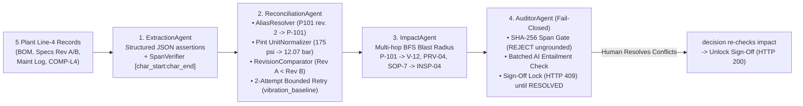

# ReconcileGraph

**Span-Anchored Industrial Engineering Change Verification & Provenance Graph**

ReconcileGraph verifies proposed industrial plant modifications against fragmented engineering records—Bills of Materials (BOMs), multi-revision equipment datasheets, field maintenance logs, Standard Operating Procedures (SOPs), and hydrostatic inspection certificates—anchoring every extracted claim to exact `[char_start : char_end]` source offsets and SHA-256 hashes before performing multi-hop impact analysis or unlocking human sign-off.

---

## 1. Problem & Thesis

Standard Retrieval-Augmented Generation (Naive RAG) and static dependency graphs break down on real-world industrial Engineering Change Orders (ECOs) for four structural reasons:

1. **Superseded Revision Pollution:** Naive vector search retrieves obsolete `SUPERSEDED` datasheets (e.g., `Pump P-101 Datasheet (Rev A)` at `8.5 bar`) alongside `RELEASED` specs (`Rev B` at `10.0 bar`).
2. **Equipment Tag Aliases & Unit Mismatches:** Field maintenance logs refer to `P-101` under the alias `"P101 rev. 2"` and record `"175 psi"`, concealing a live contradiction against `"10.0 bar"` (`175 psi = 12.07 bar`) in the released spec.
3. **Silent Missing Evidence:** Omitted baseline measurements (such as `vibration_baseline` in a technician log) are hallucinated or glossed over by single-pass LLM prompts.
4. **Incomplete Multi-Hop Blast Radius:** Upgrading `P-101` to `14.0 bar` affects downstream physical and compliance boundaries (`V-12` 12.0 bar MAWP, `PRV-04` 11.5 bar set pressure, `SOP-7` 11.0 bar shutdown interlock, and `INSP-04` 12.0 bar hydrostatic certification) that require an audit lock until resolved.

**Thesis — Reconcile Before Reasoning:** Every extracted engineering claim must pass deterministic **alias normalization**, **Pint unit conversion**, **revision precedence filtering**, and **SHA-256 character-span grounding** before graph impact analysis or ECO approval is permitted.

---

## 2. System Architecture



### 4 Specialized Agents + Deterministic Guardrails
1. **`ExtractionAgent` (`backend/agents.py`):** Reads the 5 plant records (plus any engineer-attached replacement specification) and anchors every extracted parameter assertion via `SpanVerifier.create_verified_span()` to exact `[char_start : char_end]` offsets and SHA-256 `text_hash` values, rejecting any unanchored excerpt.
2. **`ReconciliationAgent` (`backend/agents.py`, `backend/tools.py`):** Runs deterministic guardrails across all anchored claims:
   - `AliasResolver` (`RULE_ALIAS_NORM`): Normalizes tag variants (`"P101 rev. 2"`, `"P-101 Rev B"`) to canonical `"P-101"`.
   - `UnitNormalizer` (`RULE_UNIT_PINT`): Uses `pint` to convert pressure (`psi`, `bar`, `kPa`, `MPa` → `bar`), flow (`m3/h`, `gpm`, `l/min` → `m3/h`), and temperature (`degC`, `degF` → `degC`).
   - `RevisionComparator` (`RULE_REV_PRECEDENCE`): Flags `SUPERSEDED` revisions (`Rev A`) and enforces revision precedence.
   - **2-Attempt Bounded Re-Extraction Loop:** Detects missing required safety slots (`vibration_baseline` in `doc4_maint_log.md`), runs up to 2 targeted re-extraction retries (`RULE_BOUNDED_RETRY_1`, `RULE_BOUNDED_RETRY_2`), and opens an `OPEN` `MISSING_EVIDENCE` conflict when confirmed absent.
3. **`ImpactAgent` (`backend/agents.py`, `backend/db.py`):** Executes deterministic BFS (`get_downstream_subgraph`) from the target asset and evaluates proposed operating parameters against downstream MAWP, relief set pressure, interlock, and hydrostatic certification limits.
4. **`AuditorAgent` (`backend/agents.py`):** Enforces fail-closed auditing via `SpanVerifier.verify_span_by_id()` (marking any ungrounded candidate finding `REJECTED`) and runs a batched AI entailment check. Enforces an ECO Sign-Off Lock (`HTTP 409` on `POST /api/runs/{run_id}/sign-off`) until all `OPEN` conflicts are resolved via `resolve_conflict_and_recheck()`.

### Tiered Low-Latency LLM Failover (`backend/llm_client.py`)
ReconcileGraph enforces strict per-call timeouts (`8.0s` for Gemini via `HttpOptions(timeout=8000)`, `10.0s` for Groq via `httpx.post`) and fails over automatically across 3 tiers:
1. **Tier 1 — Gemini Keys (`GEMINI_API_KEYS` #1–#3):** `gemini-3.5-flash` / `gemini-3-flash-preview` (with automatic `404` model redirect caching and immediate jump to Groq on network timeouts).
2. **Tier 2 — Groq Keys (`GROQ_API_KEYS` #1–#3):** `https://api.groq.com/openai/v1/chat/completions` using `GROQ_MODEL` (`llama-3.3-70b-versatile` with live model fallback) in JSON-object mode.
3. **Tier 3 — Deterministic Guardrail Fallback (`DETERMINISTIC_FALLBACK`):** Only activates if all configured Gemini and Groq keys fail or none are configured, logging `RULE_LLM_FALLBACK` with root-cause reason and completing verification deterministically.

### SQLite WAL Provenance Store (`backend/db.py` & `backend/evaluator.py`)
- Uses `sqlite3.connect(..., timeout=30.0, check_same_thread=False)` with `PRAGMA journal_mode=WAL;` and `PRAGMA busy_timeout=30000;` across 8 provenance tables (`documents`, `spans`, `entities`, `edges`, `claims`, `conflicts`, `findings`, `audit_events`) plus `runs`.
- `run_ablation_benchmark()` runs in a dedicated, thread-safe `:memory:` SQLite connection (cached in memory) so concurrent `GET /api/ablation` and `POST /api/runs` requests never contend on database locks.

---

## 3. Application Walkthrough

1. **Minimalist Landing Screen (`LandingScreen.tsx`):** Displays the centered **ReconcileGraph** brand lockup and **Enter** button, smoothly morphing via a StrictMode-safe `1100ms` FLIP shared-element transition into the top-left header bar.
2. **Engineer ECO Intake Screen (`EcoIntakeScreen.tsx`):** Starts empty by default so the engineer chooses the target component (`P-101`, `V-12`, or `PRV-04`), uploads a `.md` / `.txt` replacement specification or enters custom parameters, or loads one of 3 **Reference Templates** before clicking **Submit & Run Verification**.
3. **3-Pane Evidence Review Workspace (`ReviewWorkspace.tsx` & `FormattedRecordViewer.tsx`):**
   - **Left Pane:** Clean scannable findings grouped into **Needs Decision**, **Resolved** (green cards showing the recorded engineering decision), **Verified**, and **Blocked: Ungrounded** (strikethrough red badge).
   - **Center Pane:** Offset-aware formatted engineering record viewer rendering headings, bordered HTML tables, bold labels, and inline badges with exact `[char_start : char_end]` amber highlighting and smooth auto-scroll.
   - **Right Pane:** Evidence & Unit Check (2-column side-by-side value comparison), **Resolve Conflict** action panel with quick presets + required rationale (auto-advancing to the next open item), and plain-English Verification Checks.
4. **Interactive Downstream Impact Map (`ImpactGraph.tsx`):** `@xyflow/react` directed graph (`P-101` → `PRV-04`, `SOP-7`, `V-12` → `INSP-04`) showing hop badges, smoothstep edge labels, and live status colors that turn green once component conflicts are resolved.
5. **Verification Log & Benchmark (`AblationView.tsx`):** Plain-English chronological step story with collapsible technical JSON details alongside a 3-way benchmark table with visual progress bars.

---

## 4. 3-Way Ablation Benchmark Results

Evaluated via `GET /api/ablation` (`backend/evaluator.py`) across all 3 Plant Line-4 scenarios (`eco_01_pump_upgrade`, `eco_02_seal_swap`, `eco_03_valve_upgrade`):

| Evaluation Metric | Retrieval-Only (Naive RAG) | Dependency-Graph-Only (Static Graph) | ReconcileGraph (Ours) |
| :--- | :---: | :---: | :---: |
| Evidence Traceability | 0.40 | 0.55 | **1.00** |
| Revision Resolution | 0.33 | 0.50 | **1.00** |
| Conflict Detection | 0.00 | 0.25 | **1.00** |
| Impact Correctness | 0.25 | 0.75 | **1.00** |
| Escalation Precision | 0.33 | 0.50 | **1.00** |
| Audit Faithfulness | 0.45 | 0.60 | **1.00** |
| **Overall Score** | **0.29** | **0.53** | **1.00** |

---

## 5. Project Structure

```text
reconcilegraph-v2/
├── data/
│   ├── corpus/
│   │   ├── doc1_bom_revB.md            # Plant Line-4 BOM (Rev B, RELEASED)
│   │   ├── doc2_pump_spec_revA.md      # P-101 Datasheet (Rev A, SUPERSEDED)
│   │   ├── doc3_pump_spec_revB.md      # P-101 Datasheet (Rev B, RELEASED)
│   │   ├── doc4_maint_log.md           # Maintenance Log MNT-2026-09 (175 psi, alias P101 rev. 2)
│   │   └── doc5_valve_sop_insp.md      # Compliance Record COMP-L4 (V-12, SOP-7, INSP-04)
│   ├── graph_seed.json                 # Canonical entities, aliases, edges, authority ranking
│   └── scenarios.json                  # ECO-01, ECO-02, ECO-03 ground-truth scenarios
├── backend/
│   ├── agents.py                       # 4-agent pipeline + conflict resolution & re-check
│   ├── db.py                           # SQLite WAL schema, corpus seeder, BFS traversal
│   ├── evaluator.py                    # Isolated in-memory 3-way ablation benchmark
│   ├── llm_client.py                   # 8s/10s timeout Gemini -> 3-key Groq failover client
│   ├── main.py                         # FastAPI server & REST endpoints
│   ├── models.py                       # Pydantic v2 provenance & audit schemas
│   ├── requirements.txt                # Python dependencies
│   └── tools.py                        # AliasResolver, UnitNormalizer, RevisionComparator, SpanVerifier
├── frontend/
│   ├── src/
│   │   ├── components/
│   │   │   ├── AblationView.tsx        # Verification log & visual 3-way benchmark
│   │   │   ├── EcoIntakeScreen.tsx     # Empty-by-default ECO intake + spec file upload
│   │   │   ├── FormattedRecordViewer.tsx # Offset-aware HTML record/table span highlighter
│   │   │   ├── ImpactGraph.tsx         # Interactive @xyflow/react downstream impact map
│   │   │   ├── IntakeBar.tsx           # Two-row header, provider badge & sign-off gate
│   │   │   ├── LandingScreen.tsx       # Minimalist landing view with FLIP morph trigger
│   │   │   └── ReviewWorkspace.tsx     # 3-pane findings, record viewer & resolver
│   │   ├── utils/docNames.ts           # Human-readable document label formatter
│   │   ├── api.ts                      # Typed fetch client
│   │   ├── App.tsx                     # Root state & FLIP choreography
│   │   ├── index.css                   # Tailwind v4 + custom scrollbar styling
│   │   ├── main.tsx                    # React entry point
│   │   └── types.ts                    # Strict TypeScript API interfaces
│   ├── index.html
│   ├── package.json
│   ├── tsconfig.json
│   └── vite.config.ts                  # Vite dev server + /api proxy
├── tests/
│   ├── test_api.py                     # Failover, workflow, sign-off lock & concurrency tests
│   └── test_tools.py                   # Seeder, Pint, alias, revision, span & BFS tests
├── .env.example
├── .gitignore
├── DEMO_SCRIPT.md
└── README.md
```

---

## 6. Quickstart & Environment Setup

### 1. Configure Environment Variables
Copy `.env.example` to `.env` in the repository root and add your API keys (or leave empty to run in offline deterministic guardrail mode):

```bash
cp .env.example .env
```

```env
GEMINI_API_KEYS=your_gemini_key_1,your_gemini_key_2,your_gemini_key_3
GEMINI_MODEL=gemini-3.5-flash
GROQ_API_KEYS=your_groq_key_1,your_groq_key_2,your_groq_key_3
GROQ_MODEL=llama-3.3-70b-versatile
```

### 2. Start the FastAPI Backend
```bash
py -m pip install -r backend/requirements.txt
py -m uvicorn backend.main:app --reload --port 8000
```

### 3. Start the React Frontend
```bash
cd frontend
npm install
npm run dev
```
Open `http://localhost:5173` (Vite proxies `/api/*` requests to `http://127.0.0.1:8000`).

### 4. Run the Test Suite & Production Build
```bash
py -m pytest -v
cd frontend && npm run build
```
