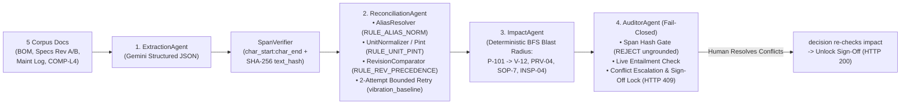

# ReconcileGraph

**Reconcile-Before-Reasoning Multi-Agent Workbench for Industrial Engineering Change Orders (ECOs)**

ReconcileGraph verifies proposed industrial plant modifications against multi-revision bills of materials, equipment datasheets, field maintenance logs, and safety compliance records—anchoring every claim to exact character offsets and SHA-256 text hashes before multi-hop impact reasoning or human sign-off.

---

## 1. Problem & Thesis

Standard Retrieval-Augmented Generation (Naive RAG) and static dependency graphs fail on real-world industrial records for four structural reasons:

1. **Superseded Revision Pollution:** Naive vector retrieval surfaces obsolete `SUPERSEDED` datasheets (e.g., `P-101 Rev A` at `8.5 bar`) alongside `RELEASED` specs (`Rev B` at `10.0 bar`).
2. **Unresolved Aliases & Unit Mismatches:** Field maintenance logs refer to `"P101 rev. 2"` and record `"175 psi"`, masking a live conflict against `"10.0 bar"` (`175 psi = 12.07 bar`) in the released datasheet.
3. **Missing Safety Evidence:** Omitted measurements (such as `vibration_baseline` in a shift log) are silently hallucinated or ignored by single-pass LLM prompts.
4. **Incomplete Multi-Hop Blast Radius:** Evaluating a pump upgrade (`14.0 bar`) requires traversing downstream physical and governance dependencies (`P-101 -> V-12 / PRV-04 -> SOP-7 -> INSP-04`) and enforcing an audit lock until human engineers resolve every open conflict.

**Thesis — Reconcile Before Reasoning:** Every extracted assertion must first pass deterministic **alias normalization**, **Pint unit conversion**, **revision precedence filtering**, and **SHA-256 character-span grounding** before graph impact analysis or sign-off is permitted.

---

## 2. 4-Agent + Deterministic Guardrail Architecture



### Deterministic Guardrails (`backend/tools.py` & `backend/db.py`)
- **`AliasResolver` (`RULE_ALIAS_NORM`):** Maps punctuation/revision variants (`"P101 rev. 2"`, `"P-101 Rev B"`) to canonical `"P-101"`.
- **`UnitNormalizer` (`RULE_UNIT_PINT`):** Uses `pint` to convert pressure (`psi`, `bar`, `kPa`, `MPa` → `bar`), flow (`m3/h`, `gpm`, `l/min` → `m3/h`), and temperature (`degC`, `degF` → `degC`).
- **`RevisionComparator` (`RULE_REV_PRECEDENCE`):** Excludes `SUPERSEDED` revisions and enforces revision ordering (`Rev A < Rev B < Rev C`, `Rev 1 < Rev 2`).
- **`SpanVerifier` (`RULE_SPAN_HASH_PROV`):** Anchors exact `[char_start : char_end]` slices in `documents.raw_text` and verifies SHA-256 `text_hash`, rejecting any ungrounded or tampered citations.

---

## 3. 3-Key Gemini Failover Setup

ReconcileGraph calls Gemini structured JSON generation (`google-genai`) first across up to 3 configured API keys and degrades transparently if all keys are unavailable or rate-limited:

1. Copy `.env.example` to `.env`:
   ```env
   GEMINI_API_KEYS=your_key_1,your_key_2,your_key_3
   GEMINI_MODEL=gemini-2.5-flash
   ```
2. **Automatic Failover (`backend/llm_client.py`):** Iterates `Key #1` → `Key #2` → `Key #3` on quota/429/auth/timeout errors and tags the active slot (`LIVE GEMINI • Key #N`) in the UI.
3. **Explicit Fallback (`DETERMINISTIC_FALLBACK`):** If no keys are configured or all 3 keys fail, `AIAgentsInaccessibleError` is caught, `RULE_LLM_FALLBACK` is logged to `audit_events`, an amber warning banner is shown in the UI, and the pipeline completes safely via deterministic guardrails.

---

## 4. Quickstart Commands

### Backend (FastAPI + SQLite)
```bash
py -m pip install -r backend/requirements.txt
py -m uvicorn backend.main:app --reload --port 8000
```

### Frontend (React + TypeScript + Tailwind + React Flow)
```bash
cd frontend
npm install
npm run dev
```
Open `http://localhost:5173` (Vite proxies `/api` requests to `http://127.0.0.1:8000`).

### Test Suite
```bash
py -m pytest -v
```

---

## 5. Ablation Results Summary

Computed via `GET /api/ablation` (`backend/evaluator.py`) across the 3 industrial ECO scenarios (`eco_01_pump_upgrade`, `eco_02_seal_swap`, `eco_03_valve_upgrade`):

| Evaluation Metric | Retrieval-Only (Naive RAG) | Dependency-Graph-Only (Static Graph) | ReconcileGraph (Ours) |
| :--- | :---: | :---: | :---: |
| Evidence Traceability | 0.40 | 0.55 | **1.00** |
| Revision Resolution | 0.33 | 0.50 | **1.00** |
| Conflict Detection | 0.00 | 0.25 | **1.00** |
| Impact Correctness | 0.25 | 0.75 | **1.00** |
| Escalation Precision | 0.33 | 0.50 | **1.00** |
| Audit Faithfulness | 0.45 | 0.60 | **1.00** |
| **Overall Score** | **0.29** | **0.53** | **1.00** |
